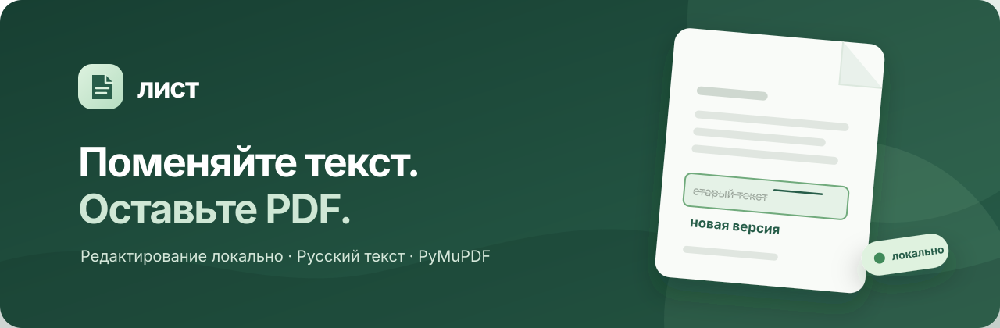

<p align="center">
  
</p>

<p align="center">
  <strong>Лёгкий редактор PDF с настоящей заменой текста.</strong><br>
  Выберите надпись, введите новую и сохраните документ — без белой плашки поверх старого текста.
</p>

<p align="center">
  
  
  
  
  
</p>

<p align="center"><a href="https://github.com/Xffxffxff228/list-pdf-editor/releases/latest">Скачать исходный код последнего релиза</a></p>

## Как это работает

1. Откройте PDF кнопкой или перетащите файл в окно. Нажмите на фрагмент текста, который нужно изменить.
2. Введите замену.
3. Скачайте готовый PDF.

Старые символы удаляются из содержимого страницы PDF, а новая строка записывается в документ. Обработка идёт на вашем компьютере: приложение не загружает файлы в интернет. PDF.js включён в исходники, поэтому для просмотра PDF CDN не нужен.

## Быстрый запуск · Windows

**Вариант A — uv**

1. Установите [uv](https://docs.astral.sh/uv/getting-started/installation/).
2. Скачайте проект и запустите `Запустить редактор.bat`.

**Вариант B — Python**

Установите Python 3.10 или новее, затем дважды щёлкните `Запустить редактор.bat`. Скрипт установит PyMuPDF и запустит локальную страницу.

Приложение откроется в браузере по адресу `127.0.0.1`. При первом запуске Python может скачать PyMuPDF из PyPI; PDF остаётся на компьютере.

## Возможности

- Замена выбранного фрагмента встроенного текста в PDF, включая русский текст.
- Просмотр многостраничных документов и навигация по страницам.
- Масштабирование, открытие перетаскиванием и скачивание результата.
- Сохранение результата в отдельный PDF-файл.
- Локальная обработка документов; максимальный размер — 100 МБ.

## Ограничения

- **Сканы:** если страница состоит из изображения, текст сначала нужно распознать через OCR.
- **Оформление:** замена работает с выбранным фрагментом, обычно с одним текстовым блоком или словом. Размер и цвет подбираются по исходному фрагменту, но точное начертание и переносы могут отличаться. Длинная замена автоматически уменьшается, чтобы поместиться.
- **Подписи и формы:** изменение страницы аннулирует цифровую подпись исходного PDF. Перед заменой проверьте, что документ не требует сохранения подписи.
- **Проверка результата:** просмотрите готовый документ перед отправкой. Приложение заменяет текстовый фрагмент, но не предназначено для юридически значимого удаления конфиденциальных сведений.

## Лицензия

Проект распространяется по лицензии [MIT](LICENSE).

История изменений: [CHANGELOG.md](CHANGELOG.md).

## Для разработчиков

```powershell
uv run --with "pymupdf>=1.24,<2" server.py
```

Или установите зависимость из `requirements.txt` и запустите:

```powershell
python server.py
```

Интерфейс: `index.html` и `app.js` · просмотр PDF: `vendor/pdfjs/` · локальный API и обработка: `server.py`.

PDF.js распространяется по лицензии Apache 2.0; текст лицензии находится в `vendor/pdfjs/LICENSE`.

